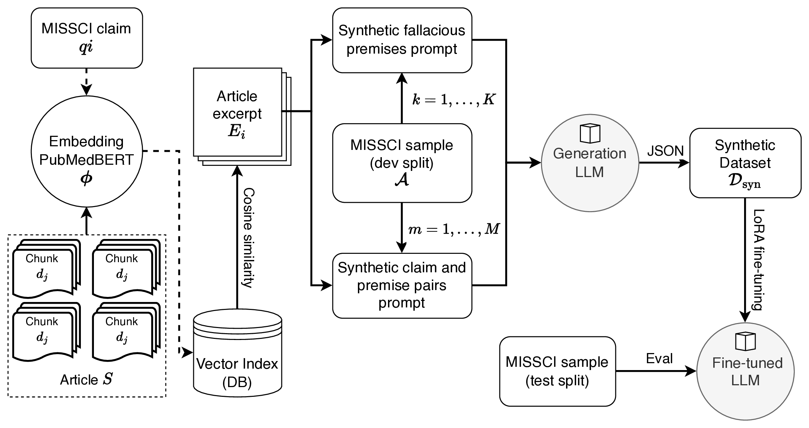

# MisSynth

## Datasets
All files are described in [dataset/](dataset/README.md).
- [o4-mini](dataset/MisSynth.o4-mini.jsonl): 15 synthetic fallacies and 5 claim–premise pairs per dev argument, the configuration selected in [Selection](#selection); the [human validation](human_validation/README.md) sample is drawn from this set
- [GPT-5 (medium)](dataset/MisSynth.gpt-5.jsonl): the same configuration generated with GPT-5 (medium reasoning effort), used in the generator comparison
## Setup
Experiment hardware: M1 MacBook Pro with 32 GB of RAM
```bash
git clone --recursive https://github.com/mxpoliakov/MisSynth.git && cd MisSynth
```
```bash
export PYTHONPATH=$(pwd):$(pwd)/missci
python -m venv .venv
source .venv/bin/activate
pip install -r requirements.txt
```
Create a JSON vector store based on scraped articles (web, pdf) from the MISSCI dev split. All 30 articles were scraped and vectorized using [NeuML/pubmedbert-base-embeddings](https://huggingface.co/NeuML/pubmedbert-base-embeddings) with a chunk size of 512 and chunk overlap of 64.
```bash
python create_vector_store.py
```
## Reproduce
Selection never uses the MISSCI test split: selection training sets are built from half of the dev arguments ([split rule](dataset/README.md#dev-split)) and scored by validation loss on the other half's gold fallacies.
### Synthetic data
Generate synthetic fallacies using the [single class prompt template](prompt_templates/single-class-synthetic-fallacy-context.txt). A vector store is used to retrieve relevant article excerpts to support the argument claim—essentially functioning as a lightweight RAG with metadata filtering. The [OpenAI o4-mini](https://openai.com/index/introducing-o3-and-o4-mini/) model is used to generate 15 synthetic fallacies per sample from the Missci [dev split](missci/dataset/dev.missci.jsonl). Each fallacy includes both a fallacious premise and context.

Additionally, 5 synthetic claim–accurate premise pairs with real fallacies are generated for each entry in the dev split, using the [synthetic claim-premise template](prompt_templates/synthetic-claim-premise.txt).

Raw generations are written to `output/<generator>-<template>[-<ablation>]-<count>`:
```bash
export OPENAI_API_KEY=...
python generate_synthetic_data.py --model-name o4-mini --prompt-template single-class-synthetic-fallacy-context --n-synthetic-entries 15
python generate_synthetic_data.py --model-name o4-mini --prompt-template synthetic-claim-premise --n-synthetic-entries 5
```
Generators: o4-mini (K = 10, 15, 30, 40; M = 5, 15, 20) and gpt-4.1, gpt-5, o3 (K = 15, M = 5). The retrieval ablations add `--no-retrieval` or `--random-source` (o4-mini, K = 15, M = 5).

The released datasets and their analysis:
```bash
python create_unified_dataset.py --model-name o4-mini --raw-output-folders o4-mini-single-class-synthetic-fallacy-context-15 \
--raw-output-folders o4-mini-synthetic-claim-premise-5
python analyze_synthetic_dataset.py
```
### Training sets
`python create_fine_tuning_dataset.py <arguments> --output-dir output/datasets/<dataset>`, with `F=o4-mini-single-class-synthetic-fallacy-context` and `P=o4-mini-synthetic-claim-premise`:

| Dataset | Arguments |
|---|---|
| o4-mini-k-15-m-5 (selected) | `--raw-output-folders $F-15 --raw-output-folders $P-5` |
| o4-mini-k-15-m-5-no-retrieval | `--raw-output-folders $F-no-retrieval-15 --raw-output-folders $P-no-retrieval-5` |
| o4-mini-k-15-m-5-random-source | `--raw-output-folders $F-random-source-15 --raw-output-folders $P-random-source-5` |
| o4-mini-k-15-m-0 | `--raw-output-folders $F-15` |
| o4-mini-k-15-m-5-random-content | `--raw-output-folders $F-15 --raw-output-folders $P-5 --random-baseline` |
| gold-dev-only | `--gold-only` |
| gpt-5-k-15-m-5 | the same as the selected set with the gpt-5 folders |
| `<dataset>-A` (selection) | the dataset's arguments and `--train-ids-file dataset/dev_split_A.txt` |

### Fine-tuning and inference
Fallacies are classified with premise using the [classify with definition template](missci/prompt_templates/cls_with_premise/classify-D.txt). The commands below train and evaluate `phi-4-4bit` on the selected dataset with seed 0.

Models: [`gemma-3-4b-it-4bit`](https://huggingface.co/mlx-community/gemma-3-4b-it-4bit), [`Llama-3.1-8B-Instruct-4bit`](https://huggingface.co/mlx-community/Llama-3.1-8B-Instruct-4bit), [`llama2-13b-qnt4bit`](https://huggingface.co/mlx-community/llama2-13b-qnt4bit), [`phi-4-4bit`](https://huggingface.co/mlx-community/phi-4-4bit), [`Mistral-Small-3.2-24B-Instruct-2506-4bit`](https://huggingface.co/mlx-community/Mistral-Small-3.2-24B-Instruct-2506-4bit). Seeds: 0, 1 and 2.

Fine-tune for one epoch:
```bash
ITERS=$(wc -l < output/datasets/o4-mini-k-15-m-5/train.jsonl)
python -m mlx_lm lora --model mlx-community/phi-4-4bit --data output/datasets/o4-mini-k-15-m-5 --train \
--fine-tune-type lora --mask-prompt --batch-size 1 --num-layers 16 --iters $ITERS --steps-per-eval $ITERS \
--val-batches 1 --seed 0 --adapter-path trained_adapters_final/adapters_phi-4-4bit_o4-mini-k-15-m-5_seed0
```
The adapter directory name `adapters_<model>_<dataset>_seed<seed>` names the prediction file that `aggregate_predictions.py` reads.

Fine-tuned model on the MISSCI test split:
```bash
python run_mlx_fallacy_classification.py --model-name phi-4-4bit \
--adapter-path trained_adapters_final/adapters_phi-4-4bit_o4-mini-k-15-m-5_seed0
```
Base model:
```bash
python run_mlx_fallacy_classification.py --model-name phi-4-4bit
```
### Selection
Selection runs train phi-4-4bit on the `-A` sets as above, with `--val-batches -1`. [selection.csv](results/selection.csv) holds the final validation loss of each run.
### Results
```bash
python aggregate_predictions.py
python analyze_predictions.py <prediction file>  # one file
```
Files: [selection.csv](results/selection.csv) (validation loss per selection run), [scores.csv](results/scores.csv) (accuracy, macro F1 and answer parsing per prediction file), [summary.csv](results/summary.csv) (per model and training dataset: base vs fine-tuned with seed spread, bootstrap CI and McNemar tests, ablations vs the full set), [per_class.csv](results/per_class.csv) (MISSCI test, MAFALDA and Logic, per model and class: base vs fine-tuned precision, recall, F1 and share of predictions, and their mean over the models), [confusion.csv](results/confusion.csv) (MISSCI test, MAFALDA and Logic confusion matrices per model and pooled over the models). `python aggregate_predictions.py --per-class` prints the per-class tables and rewrites only the last two files. Prediction files are written to `missci/predictions/classify-given-gold-premise-raw/` and scored by [aggregate_predictions.py](aggregate_predictions.py).

Selected dataset, MISSCI test split (fine-tuned: mean ± std over 3 seeds):

| Model | Size | Base acc | Base F1 | Fine-tuned acc | Fine-tuned F1 |
|---|---|---|---|---|---|
| Gemma 3 | 4B | 0.553 | 0.367 | 0.752 ± 0.014 | 0.678 ± 0.002 |
| LLaMA 3.1 | 8B | 0.419 | 0.344 | 0.740 ± 0.014 | 0.630 ± 0.017 |
| LLaMA 2 | 13B | 0.326 | 0.218 | 0.729 ± 0.049 | 0.655 ± 0.042 |
| Phi-4 | 14B | 0.667 | 0.569 | 0.775 ± 0.015 | 0.714 ± 0.019 |
| Mistral Small 3.2 | 24B | 0.698 | 0.553 | 0.804 ± 0.017 | 0.759 ± 0.029 |

## Cross-dataset sets
To test whether the pipeline generalizes beyond the MISSCI domain, we evaluate the fine-tuned models on external fallacy datasets. Adapters are from fine-tuning on MISSCI synthetic data only — no external samples are used during training. Each dataset has its own conversion script that maps source fallacy classes to the MISSCI 9-class taxonomy and produces a JSONL file compatible with the same classification pipeline.
```bash
python run_mlx_fallacy_classification.py --model-name phi-4-4bit --dataset-path dataset/mafalda.test.jsonl \
--adapter-path trained_adapters_final/adapters_phi-4-4bit_o4-mini-k-15-m-5_seed0
python run_mlx_fallacy_classification.py --model-name phi-4-4bit --dataset-path dataset/mafalda.test.jsonl  # base model
```
### MAFALDA
The [MAFALDA](https://github.com/ChadiHelwe/MAFALDA) dataset (NAACL 2024) contains 200 span-annotated text samples with 23 fallacy classes.

The conversion script maps 7 MAFALDA classes to 6 MISSCI classes:

| MAFALDA class | MISSCI class |
|---|---|
| equivocation | Ambiguity |
| causal oversimplification | Causal Oversimplification |
| false causality | Causal Oversimplification |
| false dilemma | False Dilemma / Affirming the Disjunct |
| hasty generalization | Hasty Generalization |
| false analogy | False Equivalence |
| fallacy of division | Fallacy of Division/Composition |

16 MAFALDA classes have no MISSCI equivalent (mostly emotion- and credibility-based fallacies) and are skipped. 3 MISSCI classes (Impossible Expectations, Biased Sample Fallacy, Fallacy of Exclusion) have no MAFALDA counterpart.

```bash
python create_mafalda_dataset.py  # -> dataset/mafalda.test.jsonl (103 entries)
```
### Logic
The [Logic](https://github.com/causalNLP/logical-fallacy) dataset (EMNLP 2022 Findings) contains sentence-level fallacy annotations across 13 classes from both educational (`edu_*.csv`) and climate-related (`climate_*.csv`) sources.

The conversion script maps 4 Logic classes one-to-one to MISSCI classes:

| Logic class | MISSCI class |
|---|---|
| equivocation | Ambiguity |
| false causality | Causal Oversimplification |
| false dilemma | False Dilemma / Affirming the Disjunct |
| faulty generalization | Hasty Generalization |

9 Logic classes have no MISSCI equivalent (ad hominem, ad populum, appeal to emotion, circular reasoning, fallacy of credibility, fallacy of extension, fallacy of logic, fallacy of relevance, intentional) and are skipped. 5 MISSCI classes (Biased Sample Fallacy, Fallacy of Division/Composition, Fallacy of Exclusion, False Equivalence, Impossible Expectations) have no Logic counterpart.

```bash
python create_logic_dataset.py  # -> dataset/logic.test.jsonl (1129 entries)
```
## OpenAI runner
`python run_openai_fallacy_classification.py --model-name gpt-4.1` (OpenAI API, temperature 0) writes a zero-shot prediction file for the MISSCI test split with the same prompt, parser and scoring as the base models. Once the file exists, the same command makes no API calls and prints its accuracy and macro F1 with bootstrap 95% CIs, and an exact McNemar test of each fine-tuned seed against it.
## Human validation
[Sample](human_validation/MisSynth.o4-mini.human_eval.jsonl) (`python human_validation/create_human_eval_dataset.py`), [annotation guidelines](human_validation/README.md) and [annotations](human_validation/MisSynth.o4-mini.human_eval.annotations.jsonl).
